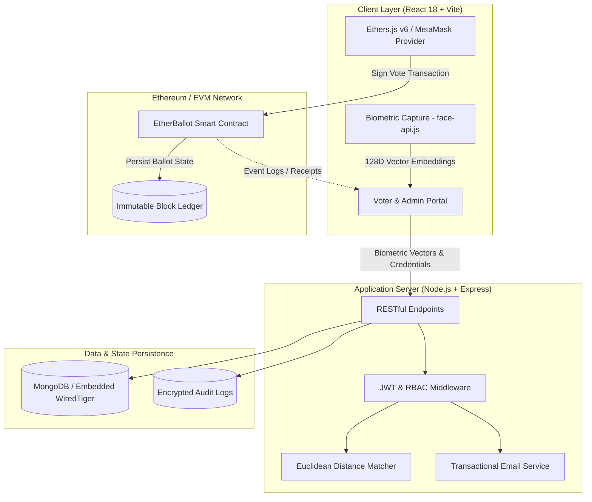
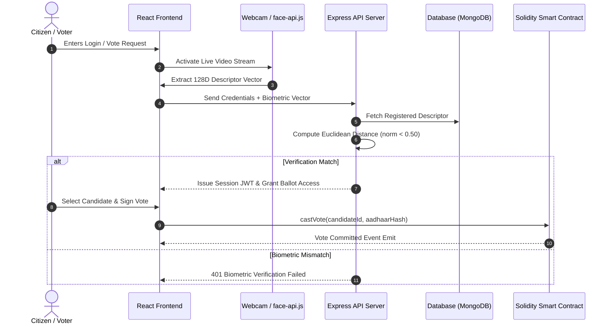

# 🗳️ EtherBallot

<p align="center">
  
  
  
  
  
  
</p>

> **Next-Generation Decentralized Electronic Voting Platform with AI Biometric Facial Recognition & Blockchain Immutability**

---

## 📌 Table of Contents

- [Overview](#-overview)
  - [Localhost Services & Endpoints](#-localhost-services--endpoints)
- [Key Features](#-key-features)
- [System Architecture](#-system-architecture)
- [Biometric & Verification Pipeline](#-biometric--verification-pipeline)
- [Technology Stack](#-technology-stack)
- [Repository Structure](#-repository-structure)
- [Prerequisites](#-prerequisites)
- [Getting Started](#-getting-started)
  - [1. Clone Repository](#1-clone-repository)
  - [2. Install Dependencies](#2-install-dependencies)
  - [3. Configure Environment Variables](#3-configure-environment-variables)
  - [4. Seed Database & Start Services](#4-seed-database--start-services)
- [API Overview](#-api-overview)
- [Smart Contract & Security Analysis](#-smart-contract--security-analysis)
- [Contributing](#-contributing)
- [License](#-license)

---

## 🌟 Overview

**EtherBallot** solves the fundamental challenges of modern democratic elections: voter impersonation, ballot stuffing, centralized manipulation, and lack of real-time transparency.

By fusing **EVM Smart Contracts**, **Client-Side AI Biometrics (`face-api.js`)**, and a **Secure Node.js & Express REST Backend**, EtherBallot delivers a trustless, cryptographically audited voting experience:

1. **Voter Registration & Verification**: Citizens register with their identity details, verify their email via secure tokens, and capture 128-dimensional facial biometric descriptors.
2. **Double-Action Authentication**: Logins require both secret credentials and live facial verification matched against stored biometric descriptors.
3. **Decentralized Balloting**: Eligible voters sign transactions via Web3 wallets (MetaMask) directly interacting with Ethereum smart contracts.
4. **Cryptographic Proofs & Audit Trail**: Every vote and administrative action generates an immutable audit record and updates on-chain state without disclosing voter identity.

### 🌐 Localhost Services & Endpoints

When running locally, EtherBallot services are hosted at:

| Service | Localhost URL | Port | Description | Access / Credentials |
|:---|:---|:---:|:---|:---|
| **Voter Web Portal** | [`http://localhost:5173`](http://localhost:5173) | `5173` | React 18 / Vite Client for Voters & Ballots | Public Citizen Access |
| **Admin Dashboard** | [`http://localhost:5173/admin/login`](http://localhost:5173/admin/login) | `5173` | Administrative Election Management & Monitoring | `superadmin` / `Admin@123456` |
| **Backend REST API** | [`http://localhost:5000`](http://localhost:5000) | `5000` | Express API Server base endpoint | Bearer JWT / Protected Endpoints |
| **API Health Check** | [`http://localhost:5000/api/health`](http://localhost:5000/api/health) | `5000` | Server status and database health check | Public Status Probe |

---

## ✨ Key Features

- 👤 **Biometric Face Recognition**:
  - 128D facial vector extraction using SSD MobileNet & ResNet embeddings in `face-api.js`.
  - Euclidean distance thresholding (<0.50 threshold) preventing proxy voting.
- 🛡️ **Dual Anti-Double-Voting Protection**:
  - On-chain wallet address mapping ensures each address can vote only once per election.
  - Keccak256 Aadhaar/National ID hash mapping prevents multi-wallet citizen duplication.
- ✉️ **Secure Email Verification**:
  - Automated transactional verification tokens with time-limited expirations.
  - Development fallback using auto-generated Ethereal inboxes or production SMTP.
- 🗄️ **Zero-Friction Database Fallback**:
  - Connects to local or remote MongoDB instances via `MONGODB_URI`.
  - Self-contained embedded in-memory MongoDB fallback with WiredTiger persistence for instant zero-config evaluation.
- 📊 **Real-Time Dynamic Dashboards**:
  - Interactive vote tallies and participation breakdown powered by Recharts and Framer Motion.
  - Live election phase transition (Draft ➔ Active ➔ Completed).
- 📜 **Role-Based Access Control (RBAC)**:
  - Granular separation between **Super Admins**, **Election Commissioners**, and **Registered Voters**.
  - Strict JWT validation, rate limiting, and NoSQL injection sanitization.

---

## 🏛️ System Architecture



---

## 🔍 Biometric & Verification Pipeline



---

## 🛠️ Technology Stack

| Layer | Technology | Purpose |
|:---|:---|:---|
| **Smart Contracts** | Solidity `^0.8.19` | Decentralized balloting, access control, event emission |
| **Blockchain Client** | Ethers.js v6 | Wallet connection, contract ABI interaction, transaction signing |
| **Frontend Framework** | React 18 & Vite 5 | Fast Single Page Application (SPA) architecture |
| **UI & Styling** | Tailwind CSS & Framer Motion | Cyberpunk-modern aesthetic, dark mode, smooth transitions |
| **Data Visualization**| Recharts | Live election analytics, candidate metrics, turnout charts |
| **Computer Vision** | `face-api.js` | Browser-based deep neural network for face detection & descriptors |
| **Backend API** | Node.js & Express | Scalable micro-framework for authentication, routing, and APIs |
| **Database** | MongoDB & Mongoose | Voter profiles, biometric descriptor vectors, and audit trails |
| **Embedded DB** | `mongodb-memory-server` | Auto-provisions localized persistence when external DB is omitted |
| **Security** | Helmet, Express Rate Limit, Bcrypt | HTTP header hardening, brute-force defense, password hashing |

---

## 📁 Repository Structure

```text
-etherballot/
├── .github/                 # CI/CD Workflows & actions
│   └── workflows/node.js.yml
├── client/                  # Frontend Single Page Application
│   ├── public/              # Static assets and face-api weights
│   ├── src/
│   │   ├── components/      # Reusable UI (FaceCapture, Navbar, ParticleCanvas)
│   │   ├── pages/           # Pages (Home, Login, Register, Voting, VerifyEmail)
│   │   ├── services/        # API client modules
│   │   └── App.jsx          # Route declarations
│   ├── package.json
│   └── vite.config.js
├── contracts/               # Solidity Smart Contracts
│   └── VotingContract.sol   # Core decentralized voting logic
├── server/                  # Backend REST API Service
│   ├── config/              # MongoDB connection & fallback configuration
│   ├── middleware/          # JWT authentication, file upload & security rules
│   ├── models/              # Mongoose schemas (User, Admin, AuditLog, VerificationToken)
│   ├── routes/              # Express API endpoints (auth, voter, election, voting)
│   ├── services/            # Email notification & transactional services
│   ├── seed-admin.js        # Super administrator initialization script
│   ├── server.js            # Express application entry point
│   ├── .env.example         # Server environment variables template
│   └── package.json
├── .env.example             # Project-wide environment template
├── .gitignore               # Ignored dependencies, build artifacts, and secrets
├── package.json             # Root orchestration scripts
└── README.md                # Comprehensive documentation
```

---

## 💻 Prerequisites

Ensure your development environment meets the following requirements:

- **Node.js**: `v18.x` or higher
- **npm**: `v9.x` or higher
- **Webcam**: Required for biometric face detection and verification
- **Web3 Wallet**: [MetaMask](https://metamask.io/) browser extension configured for an Ethereum testnet (e.g. Sepolia) or local node (Hardhat / Ganache)
- **MongoDB** *(Optional)*: A local MongoDB instance or MongoDB Atlas URI (embedded database runs automatically if not specified)

---

## 🚀 Getting Started

### 1. Clone Repository

```bash
git clone https://github.com/SHASHANKX11/-etherballot.git
cd -etherballot
```

### 2. Install Dependencies

Install root, client, and server dependencies concurrently:

```bash
npm run install-all
```

### 3. Configure Environment Variables

Create `.env` in the `server/` directory:

```bash
cp server/.env.example server/.env
```

Edit `server/.env` with your preferred configuration:

```env
PORT=5000
NODE_ENV=development
MONGODB_URI=mongodb://127.0.0.1:27017/etherballot
JWT_SECRET=your_super_secret_64_character_hex_key
CLIENT_URL=http://localhost:5173,http://127.0.0.1:5173

# Optional: Transactional Email (Leave blank in development for Ethereal test inbox)
SMTP_HOST=smtp.gmail.com
SMTP_PORT=587
SMTP_SECURE=false
SMTP_USER=your-email@example.com
SMTP_PASS=your-app-password
EMAIL_FROM="EtherBallot Commission <no-reply@etherballot.gov.in>"
APP_URL=http://localhost:5173
```

*(Optional)* Create `client/.env` to configure contract addresses and endpoints:

```env
VITE_API_URL=http://localhost:5000
VITE_CONTRACT_ADDRESS=0x0000000000000000000000000000000000000000
```

### 4. Seed Database & Start Services

Seed the initial administrator account:

```bash
npm run admin:seed
```

Launch both the backend server and Vite frontend concurrently:

```bash
npm run dev
```

- **Frontend Client**: `http://localhost:5173`
- **Backend API**: `http://localhost:5000`
- **Default Super Admin**:
  - Username: `superadmin`
  - Password: `Admin@123456`

---

## 📡 API Overview

| Method | Endpoint | Description | Access |
|:---|:---|:---|:---|
| `POST` | `/api/auth/register` | Register new voter with details & face descriptor | Public |
| `POST` | `/api/auth/login` | Authenticate with credentials and biometric check | Public |
| `GET` | `/api/auth/verify-email/:token`| Confirm voter email address | Public |
| `POST` | `/api/auth/resend-verification`| Resend verification email | Public |
| `GET` | `/api/auth/me` | Fetch authenticated session profile | Voter / Admin |
| `GET` | `/api/election` | Retrieve all active and completed elections | Authenticated |
| `POST` | `/api/election` | Create new election and candidate pool | Admin |
| `POST` | `/api/voting/cast` | Record vote commitment and verification receipt | Voter |
| `GET` | `/api/voting/results/:id` | Fetch live tally and analytical statistics | Public |

---

## 🔒 Smart Contract & Security Analysis

```text
                               SECURITY AUDIT SCORECARD
┌───────────────────────────────────────┬──────────┬─────────────────────────────┐
│ Category                              │ Rating   │ Status                      │
├───────────────────────────────────────┼──────────┼─────────────────────────────┤
│ Double-Voting Prevention              │ 9.8 / 10 │ On-chain Mapping + Hash Lock│
│ Biometric Impersonation Defense       │ 9.3 / 10 │ 128D Vector Euclidean Norm  │
│ Sybil Attack Mitigation               │ 9.5 / 10 │ Wallet + KYC Hash Binding   │
│ Ledger Immutability                   │ 9.9 / 10 │ Native EVM Event Log Proof  │
│ Injection & Transport Security        │ 9.6 / 10 │ Helmet, CORS, NoSQL Sanitize│
└───────────────────────────────────────┴──────────┴─────────────────────────────┘
```

- **Keccak256 Pseudonymization**: PII such as citizen identification numbers are converted into irreversible 32-byte cryptographic hashes before reaching the blockchain.
- **Fail-Safe Database Tier**: Prevents server startup crashes in offline or air-gapped demo settings by dynamically bootstrapping an isolated in-memory WiredTiger database instance.

---

## 🤝 Contributing

Contributions are welcomed! Follow these guidelines:

1. **Fork** the repository: [https://github.com/SHASHANKX11/-etherballot](https://github.com/SHASHANKX11/-etherballot)
2. **Create a Feature Branch**: `git checkout -b feature/voter-zk-anonymity`
3. **Commit Your Code**: `git commit -m 'feat: implement zk-SNARK ballot proof'`
4. **Push Branch**: `git push origin feature/voter-zk-anonymity`
5. **Open a Pull Request** against the `main` branch.

---

## 📜 License

This project is licensed under the [MIT License](LICENSE).

---

<p align="center">
  <b>EtherBallot</b> &bull; <i>Empowering Democratic Integrity through Decentralized Trust</i>
</p>
