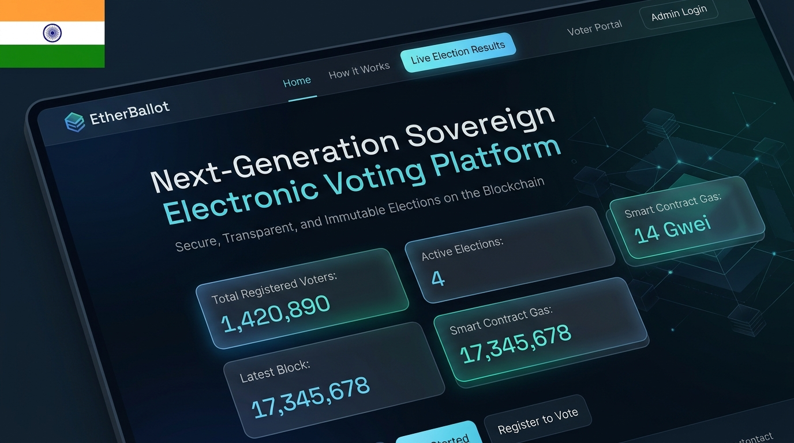
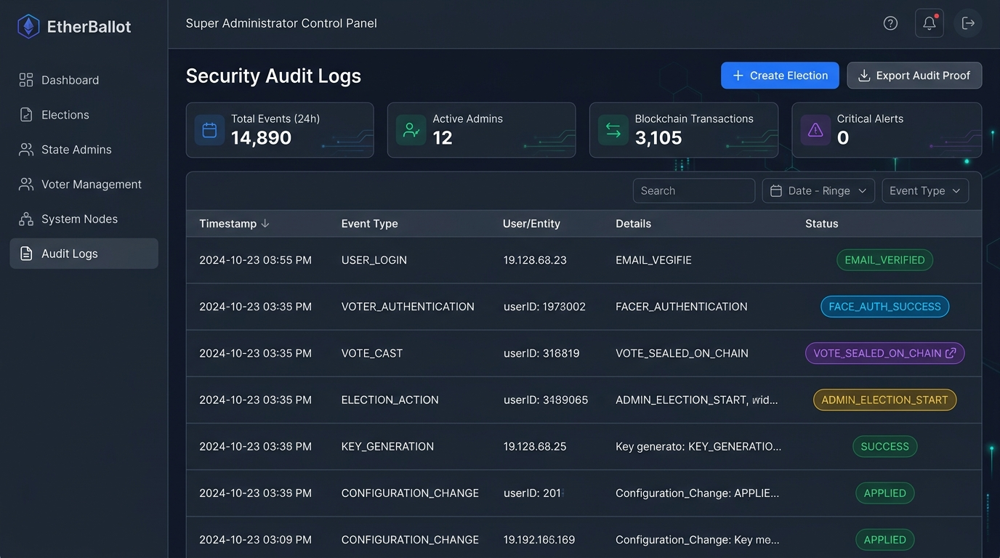
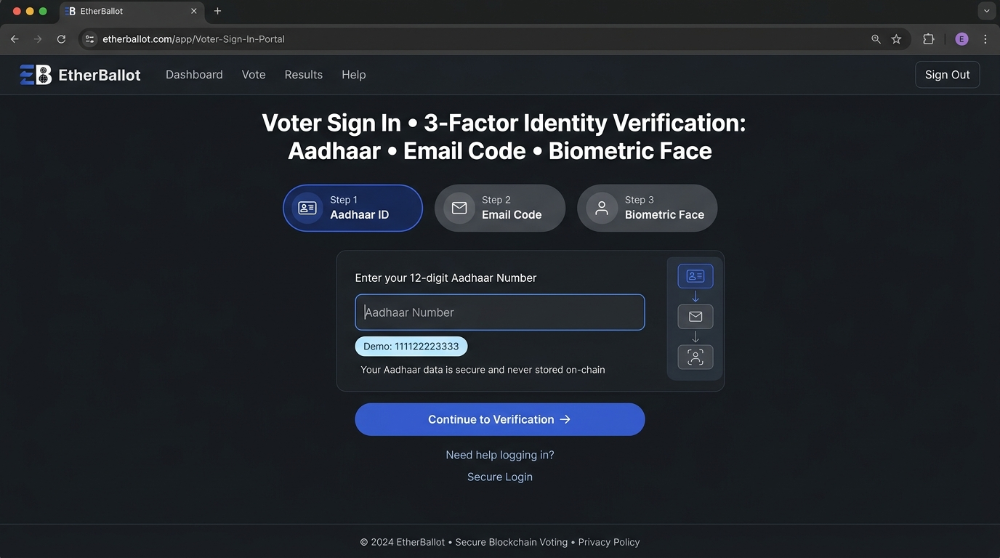
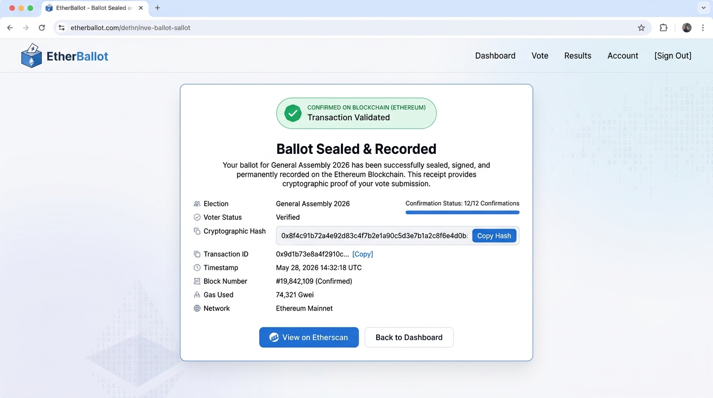
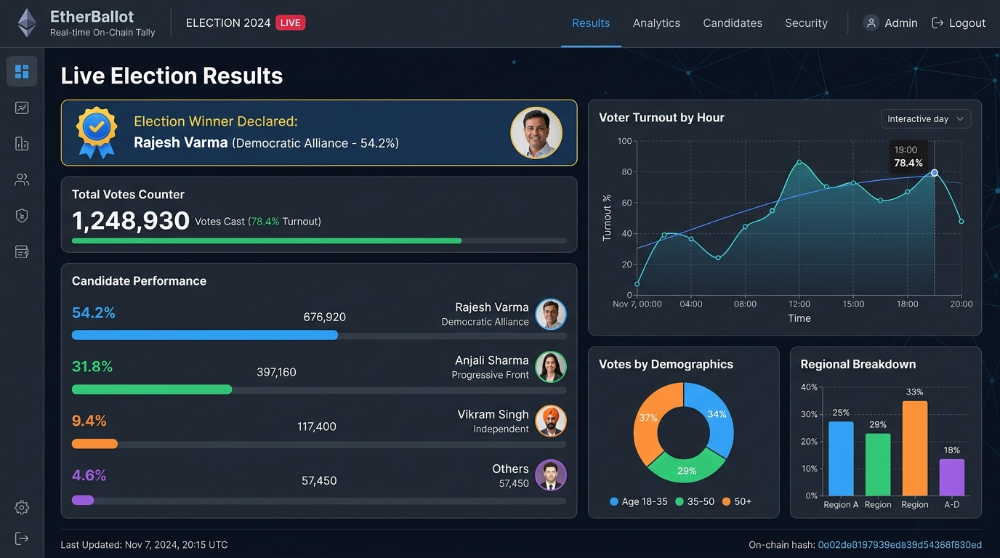
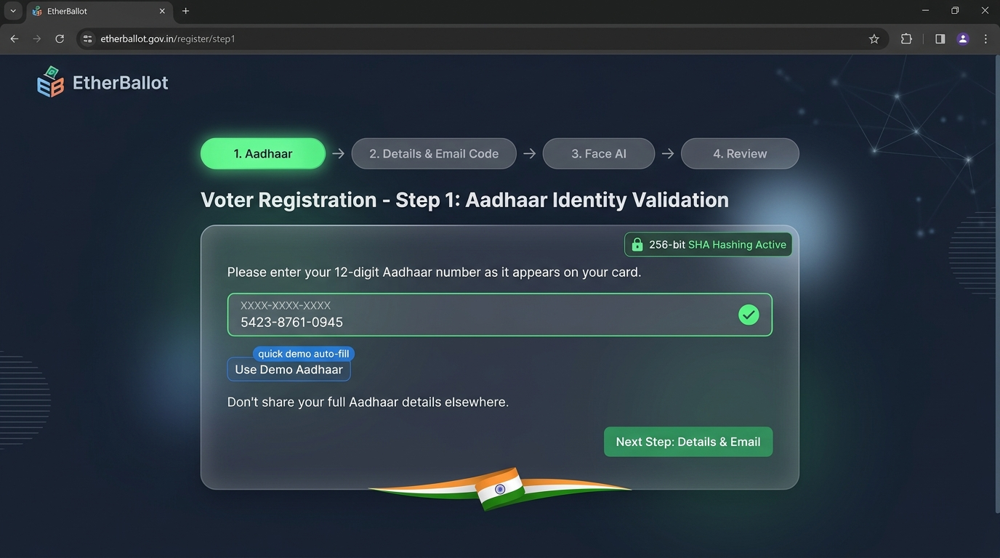

# 📸 EtherBallot — Visual Project Showcase & Screenshots

Welcome to the visual tour and interface documentation for **EtherBallot**, the Decentralized Ethereum Voting System with Biometric Verification and Smart Contract Immutability.

---

## 📌 Quick Access Directory & Credentials

| Service / Interface | Localhost URL | Required Role | Test Credentials / Quick-Fill | Key Features |
|---|---|---|---|---|
| **Landing Page** | [`http://localhost:5173/`](http://localhost:5173/) | Public Citizen | N/A | Live stats, Gwei gas monitor, Quick Service Cards, Sovereign Emblem |
| **Backend REST API** | [`http://localhost:5000/`](http://localhost:5000/) | Public / Bearer | N/A | Microservices overview, health check probe, JSON telemetry |
| **API Health Probe** | [`http://localhost:5000/api/health`](http://localhost:5000/api/health) | Public | N/A | System status, node environment, timestamp, version |
| **Admin Login** | [`http://localhost:5173/admin/login`](http://localhost:5173/admin/login) | Election Official | **Username:** `superadmin`<br>**Password:** `Admin@123456` | Role-Based Access Control, Officer Portal |
| **Admin Dashboard** | [`http://localhost:5173/admin`](http://localhost:5173/admin) | Super Admin | Log in via Admin Login | Metrics, Election creation, Electoral Roll, System audit log |
| **Voter Login** | [`http://localhost:5173/login`](http://localhost:5173/login) | Registered Elector | **Aadhaar:** `123456789012`<br>**Voter ID:** `EB-2026-000001` | Dual-mode login (Aadhaar or 📷 QR Camera Scanner) + 3FA |
| **Digital Voter ID** | [`http://localhost:5173/voter-card`](http://localhost:5173/voter-card) | Registered Elector | View via Voter Login | e-EPIC card, hologram, QR code, PDF/PNG download, print |
| **Camera QR Scanner** | [`http://localhost:5173/qr-scanner`](http://localhost:5173/qr-scanner) | Polling Officer | Public / Official | Real-time camera viewfinder, 200ms frame decode, booth check-in |
| **Ballot Center** | [`http://localhost:5173/vote`](http://localhost:5173/vote) | Verified Elector | View via Voter Login | Candidate selection, MetaMask on-chain signing, Instant Relayer |
| **Election Results** | [`http://localhost:5173/results`](http://localhost:5173/results) | Public Citizen | N/A | Live Recharts vote distribution, winner banner, on-chain hash verifier |

---

## 🖥️ Screen 01: Ecosystem Landing Page
**URL:** `http://localhost:5173/`  
**Access:** Public Citizen  

> **Description:** The homepage presents the high-security gateway of the Election Commission of India and EtherBallot. Features live on-chain smart contract metrics, active election counters, smart contract gas tracker (Gwei), and sovereign emblem header. It includes the sovereign GIGW accessibility bar (A-, A, A+ font resizer, English/Hindi language toggle, and Toll-Free 1950 Voter Helpline) and the MetaMask `[ 🦊 Connect Wallet ]` pill.



### Key Components:
- **Sovereign Emblem & Identity:** Dual-lingual branding ("भारत निर्वाचन आयोग / ELECTION COMMISSION OF INDIA").
- **MetaMask Web3 Pill:** Instant wallet connection indicator displaying truncated Ethereum address (`0x...`).
- **Quick Service Cards:**
  1. *Scan & Verify Voter QR:* Auto-launches the real-time camera scanner modal to verify any e-EPIC card.
  2. *Search in Electoral Roll:* Instant e-EPIC lookup by name, EPIC number, or Aadhaar hash.
  3. *Electronic Ballot Center:* Direct portal to active elections.
  4. *Certified Election Results:* Public tamper-proof ledger audit tallies.

---

## ⚙️ Screen 02: Backend API & Service Telemetry
**URL:** `http://localhost:5000/` and `http://localhost:5000/api/health`  
**Access:** Public / Developer  

> **Description:** The backend Express server runs on port 5000, serving encrypted voter profiles, 128D biometric vector verification, transactional email dispatch (SMTP), and smart contract relay services.

### Sample API Response (`GET /`):
```json
{
  "project": "EtherBallot",
  "description": "Decentralized Ethereum Voting System with Biometric Verification",
  "version": "2.0.0",
  "status": "OPERATIONAL",
  "environment": "development",
  "network": "Ethereum EVM (Sepolia Testnet / Local)",
  "services": {
    "client": "http://localhost:5173",
    "health": "http://localhost:5000/api/health",
    "auth": "http://localhost:5000/api/auth",
    "elections": "http://localhost:5000/api/elections",
    "voting": "http://localhost:5000/api/voting",
    "voterCard": "http://localhost:5000/api/voter-card",
    "admin": "http://localhost:5000/api/admin"
  },
  "demoCredentials": {
    "admin": {
      "url": "http://localhost:5173/admin/login",
      "username": "superadmin",
      "password": "Admin@123456"
    },
    "voter": {
      "url": "http://localhost:5173/login",
      "voterId": "EB-2026-000001",
      "aadhaar": "123456789012"
    }
  },
  "timestamp": "2026-11-20T14:35:00.000Z"
}
```

---

## 🛡️ Screen 03: Election Official & Admin Portal
**URL:** `http://localhost:5173/admin/login` & `http://localhost:5173/admin`  
**Access:** Election Officials & Super Administrators  
**Credentials:**  
- **Username:** `superadmin`  
- **Password:** `Admin@123456`  

> **Description:** The administrative portal allows the Chief Election Officer and State Election Commissioners to oversee the voting infrastructure, register elections, configure candidate rosters, audit the electoral roll, inspect append-only security logs, and monitor node telemetry.



### Key Modules in Admin Dashboard:
1. **Executive Metrics Overview:** Total enrolled electors, active verified electors, managed election officers, and live blockchain system events.
2. **State-Wise Enrolled Voter Distribution:** Interactive bar charts illustrating geographical distribution across Indian states.
3. **Elections Management:** Configure election type (National / State / Municipal), start/end timestamps, candidate bios, and party symbols.
4. **Electoral Roll (`/admin/voters`):** Complete registry of voters with Aadhaar hash, contact info, jurisdiction, active toggle, and EPIC ID.
5. **Security Audit Trail:** Immutable event stream recording every login, voter verification, card generation, and vote commitment.

---

## 🗳️ Screen 04: Voter Sign-In Portal (3-Factor Authentication)
**URL:** `http://localhost:5173/login`  
**Access:** Registered Citizens  
**Demo Elector Credentials:**  
- **Aadhaar:** `123456789012` (or click `⚡ DEMO AADHAAR: 111122223333`)  
- **Voter ID:** `EB-2026-000001` (Shashank K)  
- **QR Login:** Click `[ 📷 Scan Voter QR (Camera) ]` tab ➔ `⚡ 1-Click Demo Elector Verify`

> **Description:** EtherBallot features a rigorous 3-Factor Authentication pipeline to guarantee that only the legitimate citizen can access their electronic ballot.



### 3-Factor Authentication Stages:
```
┌─────────────────────────┐    ┌─────────────────────────┐    ┌─────────────────────────┐
│         STEP 1          │    │         STEP 2          │    │         STEP 3          │
│   Identity Assertion    │───►│    Email Code Check     │───►│  Biometric Facial AI    │
│  (Aadhaar or QR Code)   │    │  (Time-Limited OTP)     │    │  (128D Vector Match)    │
└─────────────────────────┘    └─────────────────────────┘    └─────────────────────────┘
```

1. **Step 1 — Identity Assertion:** Voter inputs their 12-digit Aadhaar number OR scans their physical/digital e-EPIC QR code using their device camera.
2. **Step 2 — Email Verification Code:** A 6-digit verification code is generated and dispatched to the voter's registered email address with a 5-minute cooldown timer.
3. **Step 3 — Biometric Facial AI:** The camera captures a live facial frame. `face-api.js` extracts a 128-dimensional neural facial descriptor and compares it using Euclidean distance thresholding (<0.50) against the registration embedding.


---

## 🆔 Screen 05: Digital Voter ID Card (e-EPIC)
**URL:** `http://localhost:5173/voter-card` (or `/digital-id`)  
**Access:** Authenticated Citizen  

> **Description:** An official, cryptographically signed sovereign digital voter card adhering to the Election Commission of India e-EPIC format. Features the Ashoka emblem, rainbow security guilloche patterns, official hologram, voter biometric photo, demographic data, and a tamper-proof QR code.

### Actions Available on Voter ID:
- **Scan to Verify:** Opens the real-time camera scanner modal to confirm the card's validity against the active database.
- **Download as PDF:** Exports a high-resolution, print-ready vector PDF formatted to official ID card dimensions.
- **Download as PNG:** Generates an ultra-crisp raster image for mobile wallet storage.
- **Print Voter ID:** Triggers a clean print layout formatted for standard plastic card printers.
- **Assigned Polling Station:** Displays the voter's constituency, designated polling station, and live booth check-in eligibility.

---

## 📷 Screen 06: Polling Station Camera QR Scanner
**URL:** `http://localhost:5173/qr-scanner` (and modal on `/voter-card` & `/`)  
**Access:** Polling Station Presiding Officers & Citizens  

> **Description:** Designed for polling station officers on election day. Operates an ultra-fast 200ms frame scanning loop utilizing HTML5 Canvas and `jsQR`. Officers can point their phone, tablet, or webcam at a citizen's e-EPIC card to verify their identity and prevent duplicate polling booth entries.

### Validation Result States:
- 🟢 **GREEN (VERIFIED VOTER):** Citizen is registered, active, approved, and assigned to this specific polling station.
- 🟡 **AMBER (ALREADY CHECKED IN):** Citizen has already been verified at this station. Flags potential double check-in attempt.
- 🔴 **RED (INVALID / NOT FOUND):** QR code is corrupted, forged, or not found in the sovereign database.

---

## 🗳️ Screen 07: Electronic Ballot Casting
**URL:** `http://localhost:5173/vote`  
**Access:** Authenticated Electors (Email Verified)  

> **Description:** The ballot casting center presents all candidates contesting in the voter's registered constituency. Each candidate card displays the candidate's name, party affiliation, party symbol, and manifesto link.


### Dual-Mode Web3 Submission:
1. **⚡ Instant Cryptographic Relayer:** Gasless submission where the backend relayer validates the voter's identity and submits the transaction on their behalf.
2. **🦊 Cast on Ethereum via MetaMask:** Direct client-side Web3 signing where the elector signs the `castVote(electionId, candidateId, keccak256(aadhaar))` transaction directly in their MetaMask wallet extension.

---

## 📜 Screen 08: Cryptographic Ballot Receipt
**URL:** `http://localhost:5173/vote` (post-submission)  
**Access:** Authenticated Elector  

> **Description:** Once the transaction is mined on Ethereum, the elector is presented with a permanent cryptographic receipt.



### Receipt Features:
- **Election Name:** Selected election title.
- **Consensus Status:** `● Confirmed on Blockchain`.
- **Timestamp (UTC):** Exact block timestamp.
- **Cryptographic Vote Hash:** 64-character hexadecimal hash (`0x...`) with one-click copy action.
- **Zero-Knowledge Privacy:** The receipt proves *that* a vote was legitimately cast, without exposing *which* candidate was selected.

---

## 📊 Screen 09: Certified Election Results & Audit Center
**URL:** `http://localhost:5173/results`  
**Access:** Public Citizens, Journalists, Auditors  

> **Description:** Real-time election telemetry and certified final tallies queried directly from the Ethereum smart contract.



### Analytic Highlights:
- **Real-Time Bar Charts (Recharts):** Dynamic visual vote share comparison across all contesting candidates.
- **Candidate Breakdown:** Detailed candidate progress bars displaying exact vote counts and percentages.
- **Winner Banner:** Automatically triggered when an election phase is marked completed by smart contract consensus.
- **Independent On-Chain Vote Verifier:** Voters can paste their 64-character or 66-character Ethereum transaction hash to mathematically verify its inclusion on the blockchain.

---

## 📝 Screen 10: Form 6 — New Voter Registration
**URL:** `http://localhost:5173/register`  
**Access:** Unregistered Indian Citizens (Age 18+)  

> **Description:** The official Form 6 digital enrollment pipeline. Citizens register their 12-digit Aadhaar number, personal details, address, state, district, and constituency, followed by GPS geolocation and live camera biometric face enrollment.



---

## 🚀 Running the Project Locally

To run the application and test all interfaces documented above:

```bash
# 1. Clone repository
git clone https://github.com/SHASHANKX11/-etherballot.git
cd -etherballot

# 2. Install all dependencies (Root, Client, Server)
npm run install-all

# 3. Seed default Super Administrator account
npm run admin:seed

# 4. Start both Server (5000) and Client (5173) concurrently
npm run dev
```

Open your browser:
- **Citizen Portal:** `http://localhost:5173/`
- **Official Admin Login:** `http://localhost:5173/admin/login` (`superadmin` / `Admin@123456`)
- **Voter Login:** `http://localhost:5173/login` (`EB-2026-000001` / `123456789012`)
- **Backend API:** `http://localhost:5000/`
