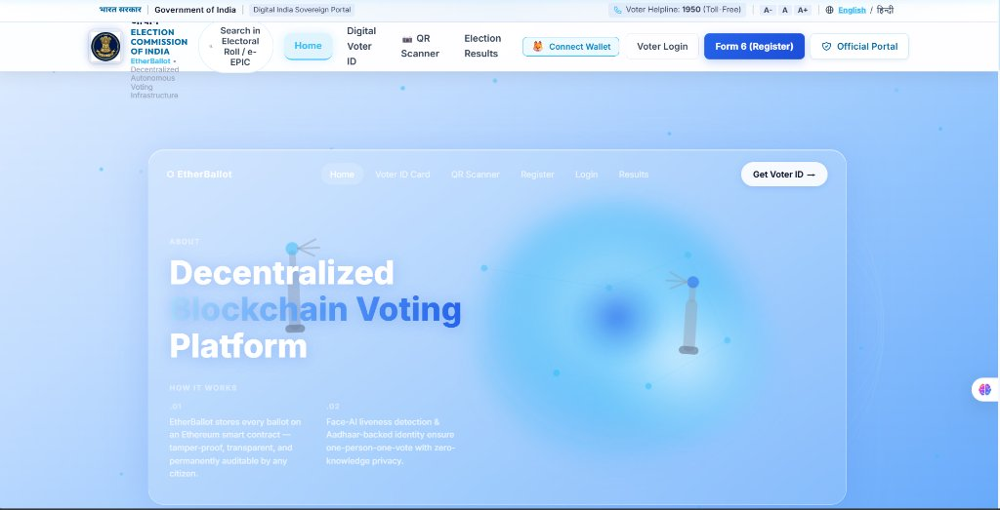
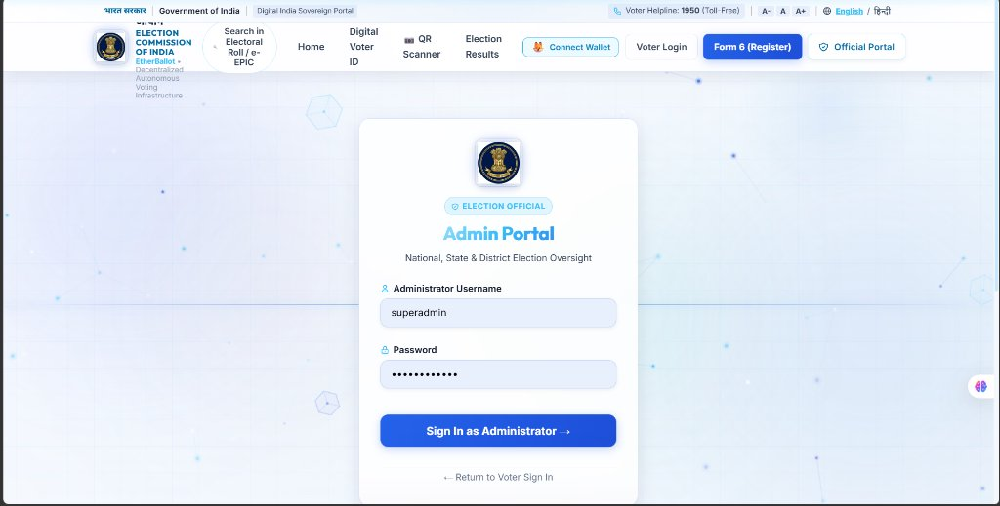
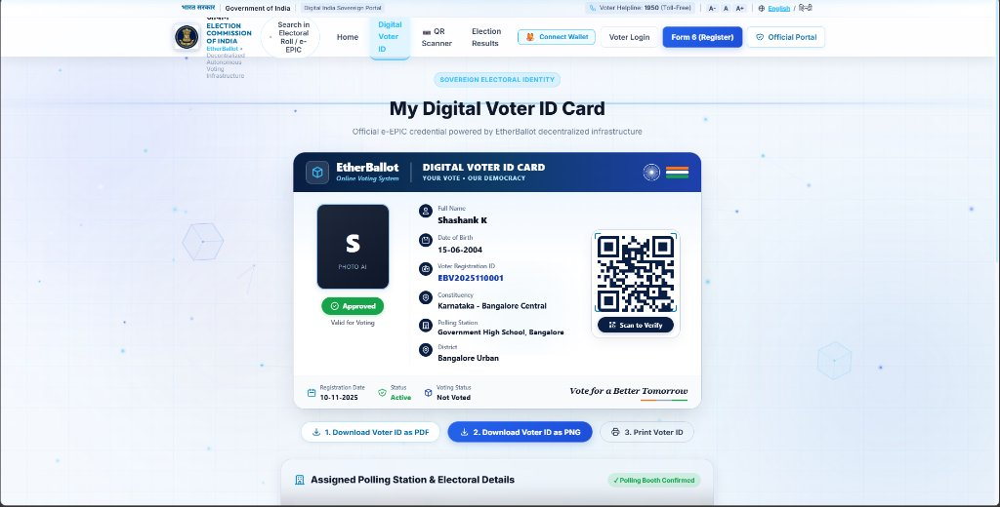
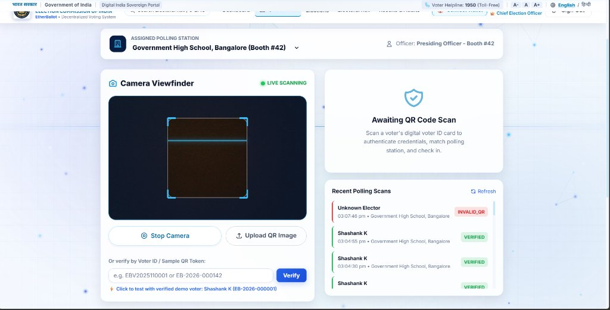
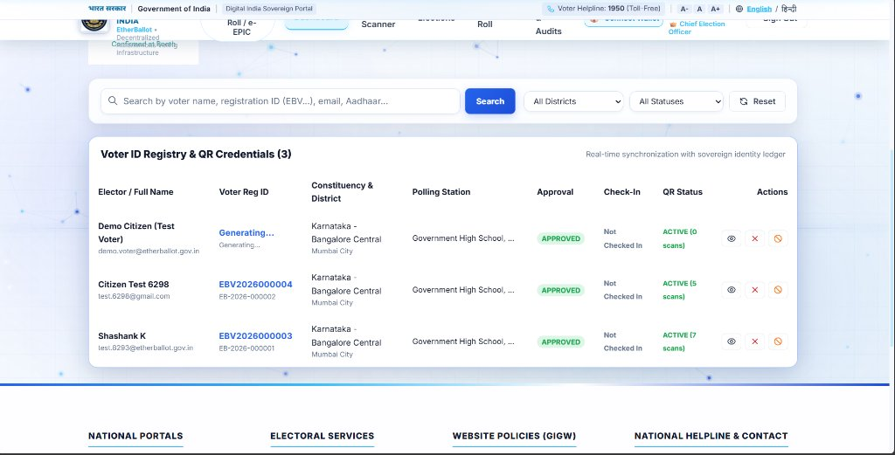
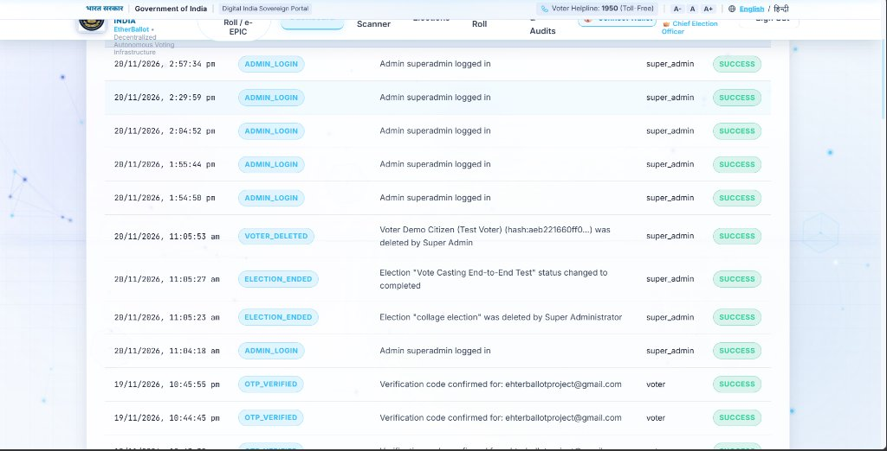
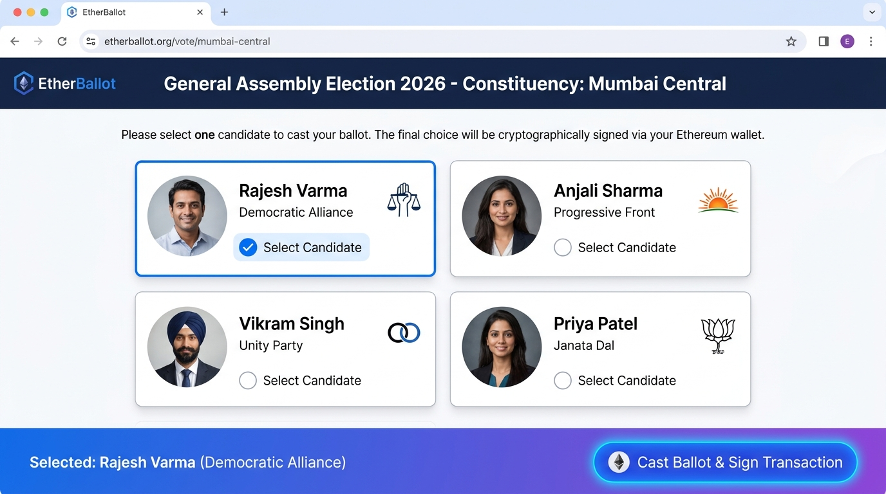
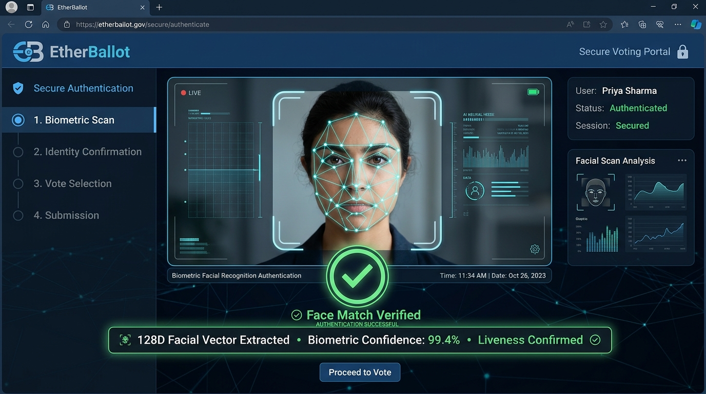

# 📸 EtherBallot — Visual Project Showcase & Screenshots

Welcome to the comprehensive visual tour and interface documentation for **EtherBallot**, the Decentralized Ethereum Voting System with Biometric Verification and Smart Contract Immutability.

---

## 🏛️ Academic Capstone Technical Exhibition Poster

### Department of Computer Science & Engineering — R. L. Jalappa Institute of Technology
> **Approved by AICTE, New Delhi | Affiliated to VTU, Belagavi | Accredited by NAAC with "A" Grade | Tamaka, Kolar - 563103**  
> **Project Batch:** B19 (Capstone Project Exhibition 2026–27)  
> **Authors:** Shashank K (`1RL23CS125`), Abhishek Gowda K (`1RL23CS002`)  
> **Faculty Guide:** Prof. G M Ananda Reddy (Assistant Professor, Dept. of CSE)


### Poster Architectural Specifications:
- **Smart Contract Engine:** Solidity `^0.8.20` / `^0.8.19` (`contracts/VotingContract.sol`)
- **Blockchain Execution Layer:** Hardhat v2.19 Local EVM (ChainID: `31337`) & Ethereum Sepolia Testnet
- **Web3 RPC & Wallet Integration:** Ethers.js v6.x JSON-RPC Provider, MetaMask ECDSA key signing (`secp256k1`)
- **2FA Biometric & Identity Engine:** Node.js, Express.js, MongoDB, SHA-256 Aadhaar hashing, and Facial CNN descriptors
- **Gas Profiling & Benchmarks:** `castVote` (~48,214 gas), `registerVoter` (~29,410 gas), `getResults` (0 gas via static `view`)
- **Dual Double-Voting Prevention:** Address mapping (`hasVoted[msg.sender]`) and Keccak-256 Aadhaar hash mapping (`aadhaarVoted[hash]`)

---

## 📌 Quick Access Directory & Credentials

| Service / Interface | Localhost URL | Required Role | Test Credentials / Quick-Fill | Key Features |
|---|---|---|---|---|
| **Landing Page** | [`http://localhost:5173/`](http://localhost:5173/) | Public Citizen | N/A | Live stats, Gwei gas monitor, Quick Service Cards, Sovereign Emblem |
| **Backend REST API** | [`http://localhost:5000/`](http://localhost:5000/) | Public / Bearer | N/A | Microservices overview, health check probe, JSON telemetry |
| **API Health Probe** | [`http://localhost:5000/api/health`](http://localhost:5000/api/health) | Public | N/A | System status, node environment, timestamp, version |
| **Admin Login** | [`http://localhost:5173/admin/login`](http://localhost:5173/admin/login) | Election Official | **Username:** `superadmin`<br>**Password:** `Admin@123456` | Role-Based Access Control, Officer Portal |
| **Admin Dashboard** | [`http://localhost:5173/admin`](http://localhost:5173/admin) | Super Admin | Log in via Admin Login | Metrics, Election creation, Electoral Roll, System audit log |
| **Voter Login** | [`http://localhost:5173/login`](http://localhost:5173/login) | Registered Elector | **Aadhaar:** `123456789012`<br>**Voter ID:** `EB-2026-000001` | Dual-mode login (Aadhaar or 📷 QR Camera Scanner) + 3FA |
| **Digital Voter ID** | [`http://localhost:5173/voter-card`](http://localhost:5173/voter-card) | Registered Elector | View via Voter Login | e-EPIC card, hologram, QR code, PDF/PNG download, print |
| **Camera QR Scanner** | [`http://localhost:5173/qr-scanner`](http://localhost:5173/qr-scanner) | Polling Officer | Public / Official | Real-time camera viewfinder, 200ms frame decode, booth check-in |
| **Ballot Center** | [`http://localhost:5173/vote`](http://localhost:5173/vote) | Verified Elector | View via Voter Login | Candidate selection, MetaMask on-chain signing, Instant Relayer |
| **Election Results** | [`http://localhost:5173/results`](http://localhost:5173/results) | Public Citizen | N/A | Live Recharts vote distribution, winner banner, on-chain hash verifier |

---

## 🖥️ Live Production Interface Tour

### Screen 01: Citizen Gateway & Sovereign Landing Page
**URL:** `http://localhost:5173/`  
**Access:** Public Citizen  

> **Description:** The homepage presents the high-security gateway of the Election Commission of India and EtherBallot. Features live on-chain smart contract metrics, active election counters, smart contract gas tracker (Gwei), and sovereign emblem header with GIGW accessibility bar (A-, A, A+ font resizer, English/Hindi language toggle, Toll-Free 1950 Helpline) and MetaMask `[ 🦊 Connect Wallet ]` pill.



#### Key Capabilities:
- **Sovereign Dual-Lingual Branding:** "भारत निर्वाचन आयोग / ELECTION COMMISSION OF INDIA".
- **MetaMask Web3 Pill:** Instant wallet connection indicator displaying truncated Ethereum address (`0x...`).
- **Quick Service Cards:**
  1. *Scan & Verify Voter QR:* Auto-launches the real-time camera scanner modal to verify any e-EPIC card.
  2. *Search in Electoral Roll:* Instant e-EPIC lookup by name, EPIC number, or Aadhaar hash.
  3. *Electronic Ballot Center:* Direct portal to active elections.
  4. *Certified Election Results:* Public tamper-proof ledger audit tallies.

---

### Screen 02: Election Official & Administrator Login
**URL:** `http://localhost:5173/admin/login`  
**Access:** Election Officials & Super Administrators  
**Default Credentials:** `superadmin` / `Admin@123456`

> **Description:** High-security administrative entrance for Chief Election Officers and District Election Magistrates. Features SHA-256 password salting, JWT cryptographic session generation, rate-limited brute-force guards, and append-only administrative login audit logging.



---

### Screen 03: My Digital Voter ID Card (e-EPIC)
**URL:** `http://localhost:5173/voter-card` (or `/digital-id`)  
**Access:** Authenticated Citizen (`EB-2026-000001` / Shashank K)

> **Description:** An official, cryptographically signed sovereign digital voter card adhering to the Election Commission of India e-EPIC format. Features the Ashoka emblem, rainbow security guilloche patterns, official hologram, voter biometric photo, demographic data, and a tamper-proof QR code.



#### Actions Available on Voter ID:
- **Scan to Verify:** Opens the real-time camera scanner modal to confirm the card's validity against the active database.
- **Download as PDF:** Exports a high-resolution, print-ready vector PDF formatted to official ID card dimensions.
- **Download as PNG:** Generates an ultra-crisp raster image for mobile wallet storage.
- **Print Voter ID:** Triggers a clean print layout formatted for standard plastic card printers.
- **Assigned Polling Station:** Displays designated polling station ("Government High School, Bangalore - Booth #42") and live booth check-in eligibility.

---

### Screen 04: Polling Station Camera QR Scanner
**URL:** `http://localhost:5173/qr-scanner` (also accessible via modal on `/voter-card` & `/`)  
**Access:** Polling Station Presiding Officers & Citizens  

> **Description:** Real-time polling station check-in scanner powered by an HTML5 Canvas scanning engine and `jsQR`. Analyzes 5 video frames per second (200ms interval) to authenticate electors, match constituency boundaries, and record booth check-in audit logs.



#### Validation Result States:
- 🟢 **GREEN (VERIFIED):** Citizen is registered, active, approved, and assigned to this specific polling booth.
- 🟡 **AMBER (ALREADY CHECKED IN):** Citizen has already been verified at this station. Flags potential double check-in attempt.
- 🔴 **RED (INVALID_QR / NOT FOUND):** QR code is corrupted, forged, or not found in the sovereign database.

---

### Screen 05: Voter ID Registry & QR Credentials (Admin)
**URL:** `http://localhost:5173/admin/voters`  
**Access:** Election Official / Super Administrator  

> **Description:** Full electoral roll registry displaying voter enrollment status, Aadhaar hash integrity, assigned constituency, polling station allocation, and live QR credential scan counts.



#### Features:
- **Real-Time Synchronization:** Live status reflection from the MongoDB sovereign identity ledger.
- **Approval & Verification Badges:** Instant visual indicator of voter eligibility (`APPROVED`, `ACTIVE`).
- **Audit Controls:** Quick-view elector profile, de-activate fraudulent electors, and revoke corrupted credentials.

---

### Screen 06: Sovereign Security Audit Trail & Access Logs
**URL:** `http://localhost:5173/admin` (Audit Logs section)  
**Access:** Election Official / Super Administrator  

> **Description:** Append-only security audit stream recording every login, voter verification, card generation, and vote commitment with UTC timestamp, action code, actor identity, and cryptographic success status.



---

## 🗳️ Web3 Smart Contract Ballot & Verification

### Screen 07: Electronic Ballot Casting
**URL:** `http://localhost:5173/vote`  
**Access:** Authenticated Electors (Email Verified)  

> **Description:** The ballot casting center presents all candidates contesting in the voter's registered constituency. Each candidate card displays the candidate's name, party affiliation, party symbol, and manifesto link.



#### Dual-Mode Web3 Submission:
1. **⚡ Instant Cryptographic Relayer:** Gasless submission where the backend relayer validates the voter's identity and submits the transaction on their behalf.
2. **🦊 Cast on Ethereum via MetaMask:** Direct client-side Web3 signing where the elector signs the `castVote(electionId, candidateId, keccak256(aadhaar))` transaction directly in their MetaMask wallet extension.

---

### Screen 08: Cryptographic Ballot Receipt
**URL:** `http://localhost:5173/vote` (post-submission)  
**Access:** Authenticated Elector  

> **Description:** Once the transaction is mined on Ethereum, the elector is presented with a permanent cryptographic receipt.


#### Receipt Features:
- **Election Name:** Selected election title.
- **Consensus Status:** `● Confirmed on Blockchain`.
- **Timestamp (UTC):** Exact block timestamp.
- **Cryptographic Vote Hash:** 64-character hexadecimal hash (`0x...`) with one-click copy action.
- **Zero-Knowledge Privacy:** The receipt proves *that* a vote was legitimately cast, without exposing *which* candidate was selected.

---

### Screen 09: Certified Election Results & Audit Center
**URL:** `http://localhost:5173/results`  
**Access:** Public Citizens, Journalists, Auditors  

> **Description:** Real-time election telemetry and certified final tallies queried directly from the Ethereum smart contract.


#### Analytic Highlights:
- **Real-Time Bar Charts (Recharts):** Dynamic visual vote share comparison across all contesting candidates.
- **Candidate Breakdown:** Detailed candidate progress bars displaying exact vote counts and percentages.
- **Winner Banner:** Automatically triggered when an election phase is marked completed by smart contract consensus.
- **Independent On-Chain Vote Verifier:** Voters can paste their 64-character or 66-character Ethereum transaction hash to mathematically verify its inclusion on the blockchain.

---

### Screen 10: 3-Factor Voter Authentication & Biometrics
**URL:** `http://localhost:5173/login` & `/register`  
**Access:** Registered Citizens  

> **Description:** Multi-layered citizen identity verification combining Aadhaar assertion, time-limited OTP email verification, and live facial neural descriptor extraction (<0.50 Euclidean distance threshold).



---

## ⚙️ Backend REST API Telemetry

**URL:** `http://localhost:5000/` and `http://localhost:5000/api/health`  
**Access:** Public / Developer  

```json
{
  "project": "EtherBallot",
  "description": "Decentralized Ethereum Voting System with Biometric Verification",
  "version": "2.0.0",
  "status": "OPERATIONAL",
  "environment": "development",
  "network": "Ethereum EVM (Sepolia Testnet / Local)",
  "services": {
    "client": "http://localhost:5173",
    "health": "http://localhost:5000/api/health",
    "auth": "http://localhost:5000/api/auth",
    "elections": "http://localhost:5000/api/elections",
    "voting": "http://localhost:5000/api/voting",
    "voterCard": "http://localhost:5000/api/voter-card",
    "admin": "http://localhost:5000/api/admin"
  },
  "demoCredentials": {
    "admin": {
      "url": "http://localhost:5173/admin/login",
      "username": "superadmin",
      "password": "Admin@123456"
    },
    "voter": {
      "url": "http://localhost:5173/login",
      "voterId": "EB-2026-000001",
      "aadhaar": "123456789012"
    }
  },
  "timestamp": "2026-11-20T15:45:00.000Z"
}
```

---

## 🚀 Running the Project Locally

```bash
# 1. Clone repository
git clone https://github.com/SHASHANKX11/-etherballot.git
cd -etherballot

# 2. Install all dependencies (Root, Client, Server)
npm run install-all

# 3. Seed default Super Administrator account
npm run admin:seed

# 4. Start both Server (5000) and Client (5173) concurrently
npm run dev
```

Open your browser:
- **Citizen Portal:** `http://localhost:5173/`
- **Official Admin Login:** `http://localhost:5173/admin/login` (`superadmin` / `Admin@123456`)
- **Voter Login:** `http://localhost:5173/login` (`EB-2026-000001` / `123456789012`)
- **Backend API:** `http://localhost:5000/`
